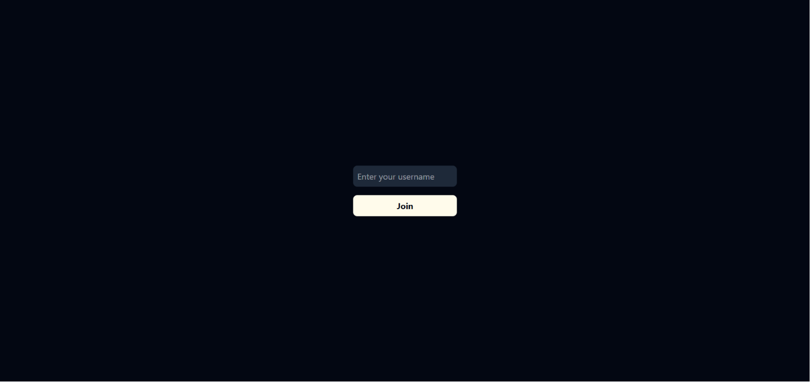
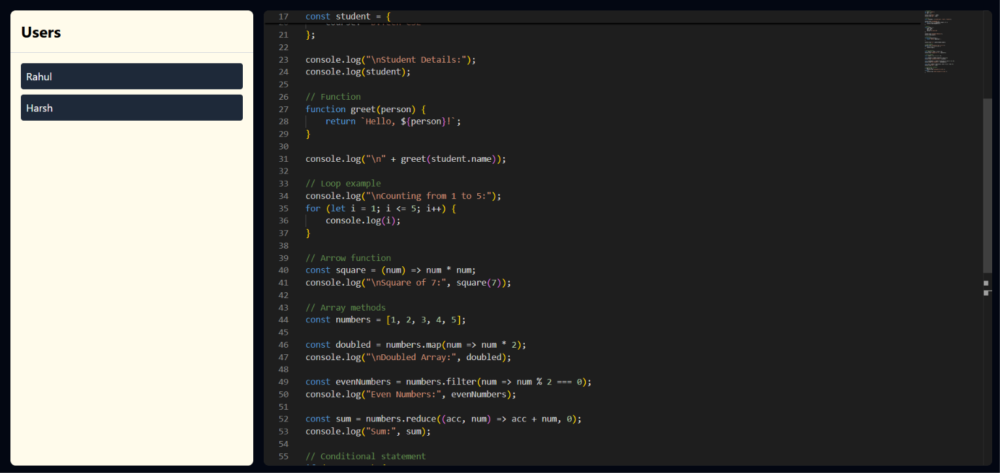

<div align="center">

# ⚡ MergeConflict

**Real-time collaborative code editing — conflict free, by design.**

[](https://nodejs.org)
[](https://react.dev)
[](https://vitejs.dev)
[](https://socket.io)
[](https://docker.com)
[](LICENSE)

</div>

---

## ✨ What is MergeConflict?

**MergeConflict** is a real-time, multi-user collaborative code editor that lives entirely in the browser. Multiple developers can open the same URL, see each other's cursors, and type simultaneously — all edits merge automatically using [Yjs](https://yjs.dev) CRDTs, so there are never any actual merge conflicts.

Think Google Docs, but for code — powered by Monaco Editor (the same engine behind VS Code).

---

## 🖥️ Screenshots

### Landing — Username Entry



A minimal, full-screen prompt collects a username. The value is appended to the URL as `?username=<name>` so sessions can be bookmarked or shared directly.

---

### Main Editor — Collaborative Session



The layout is split into:
- **Left sidebar (25%)** — live-updating list of all connected users, tracked via Yjs Awareness
- **Right editor (75%)** — the full Monaco editor in VS Dark theme, synchronized in real time across all connected clients

---

## 🏗️ Architecture

```
┌─────────────────────────────────────────────────────────────────┐
│                        Browser Clients                          │
│                                                                 │
│   ┌─────────────┐     ┌─────────────┐     ┌─────────────┐      │
│   │  Browser A  │     │  Browser B  │     │  Browser C  │      │
│   │  Monaco Ed  │     │  Monaco Ed  │     │  Monaco Ed  │      │
│   │  y-monaco   │     │  y-monaco   │     │  y-monaco   │      │
│   │ y-socket.io │     │ y-socket.io │     │ y-socket.io │      │
│   └──────┬──────┘     └──────┬──────┘     └──────┬──────┘      │
└──────────┼────────────────────┼────────────────────┼────────────┘
           │      WebSocket     │      WebSocket     │
           └────────────────────┼────────────────────┘
                                │
┌───────────────────────────────▼─────────────────────────────────┐
│                    Docker Container  :3000                       │
│                                                                 │
│   Socket.IO ──► YSocketIO ──► Yjs Document                      │
│        │                          │                             │
│   Awareness                  LevelDB Persistence                │
│   (online users)            (./storage on disk)                 │
│                                                                 │
│   Static files served from /public  ←  Built React + Vite      │
└─────────────────────────────────────────────────────────────────┘
```

### Data Flow

1. Each browser initialises a `Y.Doc` (a shared Yjs document)
2. `SocketIOProvider` connects to the server and joins room `"monaco-room"`
3. The server's `YSocketIO` syncs CRDT updates between all clients in that room
4. `MonacoBinding` bridges the Yjs text type to Monaco's editor model — edits appear instantly for everyone
5. `provider.awareness` broadcasts each user's `{ username }` so the sidebar stays current
6. `LeveldbPersistence` saves every document update to disk — sessions survive server restarts

---

## 🛠️ Tech Stack

| Layer | Technology | Purpose |
|-------|-----------|---------|
| **Frontend framework** | React 19 + Vite 8 | Fast SPA with HMR in dev |
| **Code editor** | Monaco Editor (`@monaco-editor/react`) | VS Code-grade editing experience |
| **Styling** | Tailwind CSS v4 | Utility-first, zero config |
| **Real-time transport** | Socket.IO v4 | Bidirectional WebSocket communication |
| **CRDT sync** | Yjs + y-socket.io | Conflict-free collaborative editing |
| **Editor binding** | y-monaco | Connects Yjs doc to Monaco model |
| **Backend** | Node.js + Express 5 | HTTP server + static file serving |
| **Persistence** | y-leveldb | Disk-backed document storage |
| **Containerisation** | Docker (multi-stage build) | Single-image deploy |

---

## 📁 Project Structure

```
MergeConflict/
├── Frontend/                   # Vite + React application
│   ├── src/
│   │   ├── app/
│   │   │   ├── App.jsx         # Root component — editor + sidebar + auth
│   │   │   └── App.css         # Tailwind entry (@import "tailwindcss")
│   │   └── main.jsx            # React DOM entry point
│   ├── public/
│   │   ├── favicon.svg
│   │   └── icons.svg
│   ├── index.html              # SPA shell
│   ├── vite.config.js          # Vite config (React plugin, Tailwind, Monaco deps)
│   ├── eslint.config.js
│   └── package.json
│
├── Backend/                    # Express + Socket.IO server
│   ├── server.js               # Full server — Socket.IO, Yjs, LevelDB, static serve
│   └── package.json
│
├── screenshots/                # README screenshots
│   ├── EnterName.png
│   └── editor.png
│
├── Dockerfile                  # Multi-stage: build frontend → embed in backend image
├── .dockerignore
└── .gitignore
```

---

## 🚀 Getting Started

### Prerequisites

- [Node.js](https://nodejs.org) v20+
- npm

### Local Development

**1. Clone the repo**

```bash
git clone https://github.com/rahulgoyal83789/MergeConflict.git
cd MergeConflict
```

**2. Start the backend**

```bash
cd Backend
npm install
npm run dev        # uses nodemon for hot-reload
```

The server starts on **http://localhost:3000**

**3. Start the frontend (in a new terminal)**

```bash
cd Frontend
npm install
npm run dev        # Vite dev server with HMR
```

The frontend starts on **http://localhost:5173** (or next available port).

> **Note:** Set `VITE_SOCKET_URL=http://localhost:3000` in `Frontend/.env.local` if the frontend can't auto-detect the backend.

**4. Open multiple tabs**

Navigate to the frontend dev URL, enter different usernames in each tab, and start typing. Changes sync instantly across all sessions.

---

## 🐳 Docker Deployment

The included `Dockerfile` uses a **multi-stage build**:

1. **Stage 1** — Builds the React frontend with Vite, producing a `dist/` folder
2. **Stage 2** — Copies the Express backend, installs production deps, then copies `dist/` into `./public/`

The final image is lean: only the Node.js runtime + backend + compiled frontend assets.

```bash
# Build the image
docker build -t mergeconflict .

# Run it
docker run -p 3000:3000 mergeconflict
```

Open **http://localhost:3000** — the Express server serves the built React app and handles WebSocket connections on the same port.

---

## ⚙️ Configuration

| Variable | Location | Default | Description |
|----------|----------|---------|-------------|
| `PORT` | Backend env | `3000` | HTTP + WebSocket port |
| `VITE_SOCKET_URL` | Frontend env | `window.location.origin` | Socket.IO server URL |

In production, if the frontend and backend share the same origin (as they do in the Docker image), no env vars are needed — `window.location.origin` works automatically.

---

## 🔑 Key Implementation Details

### CRDT-based conflict resolution

MergeConflict uses [Yjs](https://yjs.dev), a high-performance CRDT (Conflict-free Replicated Data Type) library. Any number of clients can edit simultaneously — changes are merged mathematically without conflicts, regardless of network latency or message ordering.

### Awareness (live user list)

Socket.IO broadcasts each connected client's `awareness` state (currently `{ username }`). The React component listens for `"change"` events on `provider.awareness` and re-renders the sidebar. When a user closes their tab, `beforeunload` sets their awareness state to `null`, removing them from the list.

### Persistence across restarts

The backend wraps Yjs with `LeveldbPersistence` (stored in `./storage/`). When a new client connects to a room, Yjs loads the persisted state from disk and applies any pending updates — so editors reload exactly where they left off after a server restart.

### Monaco integration

`MonacoBinding` from `y-monaco` syncs the Yjs `Y.Text` type (keyed as `"monaco"`) directly to Monaco's internal text model. End-of-line sequences are normalised to LF on mount to prevent cross-platform conflicts.

---

## 🗺️ Roadmap Ideas

- [ ] Multiple rooms / document selector
- [ ] Per-user cursor colours and name labels inside the editor
- [ ] Language selector (Monaco supports 80+ languages)
- [ ] Authentication & room access control
- [ ] Chat sidebar alongside the editor
- [ ] Export / copy code button
- [ ] Deployment to Railway / Fly.io / Render one-click

---

## 🤝 Contributing

1. Fork the repository
2. Create a feature branch — `git checkout -b feat/your-feature`
3. Commit your changes
4. Open a pull request

---

## 📄 License

ISC — see [LICENSE](LICENSE) for details.

---

<div align="center">

Built with ❤️ using [Yjs](https://yjs.dev), [Monaco Editor](https://microsoft.github.io/monaco-editor/), [Socket.IO](https://socket.io), and [React](https://react.dev).

**No merge conflicts. Just code.**

</div>
